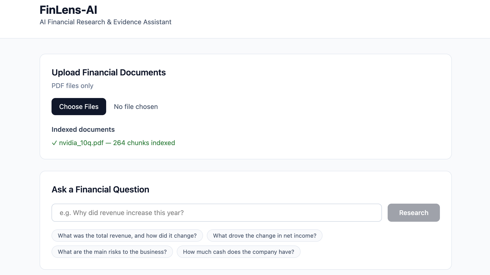
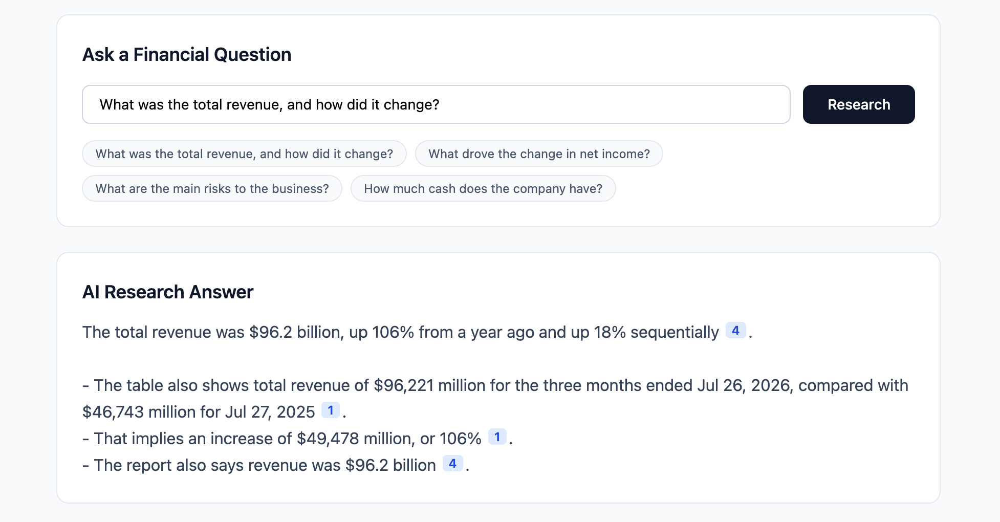
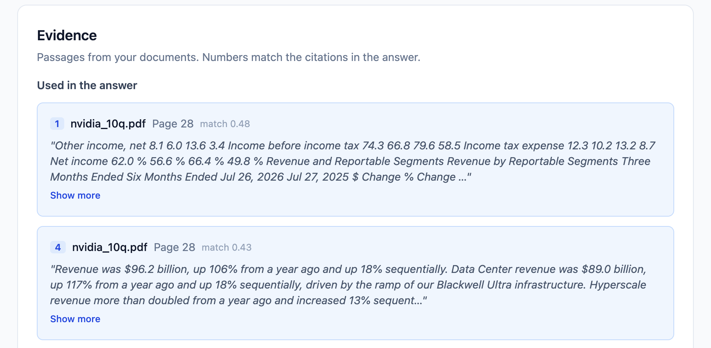
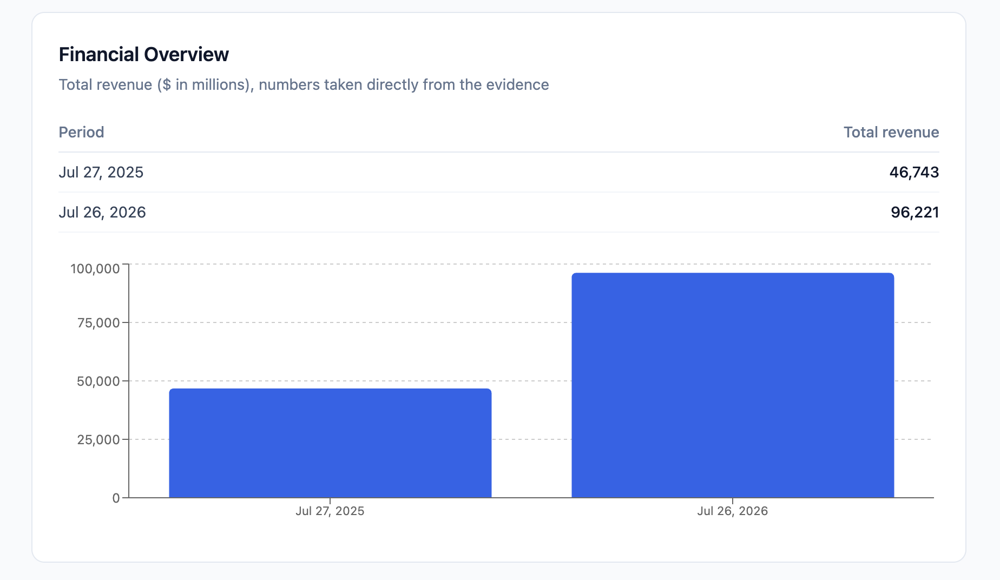

# FinLens-AI

**AI Financial Research & Evidence Assistant**: upload financial PDFs, ask questions in plain English, and get answers **grounded in your documents**, with page-level citations you can verify.

FinLens-AI is a Retrieval-Augmented Generation (RAG) application. It does not answer from the model's general knowledge: it retrieves evidence from the documents you upload, answers only from that evidence, and clearly says when the documents don't contain the answer.



## Features

- **Document upload**: any financial PDF (annual reports, 10-Q/10-K filings, earnings releases). No company-specific logic.
- **Grounded answers**: the LLM answers only from retrieved evidence, with citations like [1] [2].
- **Clickable citations**: each citation links to the exact passage, document and page number.
- **Two-layer hallucination protection**:
  1. a calibrated **distance threshold** rejects off-topic questions before the LLM is called;
  2. a **grounded prompt** makes the LLM reply "not enough information" when the evidence doesn't answer the question.
- **Financial overview chart**: when the evidence contains one metric across periods, it is extracted as structured data and shown as a table + bar chart. Every extracted number is **verified against the source text** before it is shown.
- **Clear error handling**: invalid or scanned PDFs, oversized files, missing API key, OpenAI errors, backend offline.

| Answer with citations and chart | Evidence with page numbers |
|---|---|
|  |  |


## How it works

**Pipeline:** Document → Text → Chunks → Embeddings → Vector DB → Retrieval → Context → LLM → Grounded Answer → Evidence

Every answer can be traced back to its source:
`answer citation [1] → retrieved chunk → document + page → original PDF`

## Tech stack

| Layer | Technology |
|---|---|
| Frontend | React, Vite, Tailwind CSS, Recharts |
| Backend | Python, FastAPI, Uvicorn, Pydantic |
| PDF processing | PyMuPDF |
| Embeddings | OpenAI `text-embedding-3-small` |
| LLM | OpenAI chat model (configurable in `backend/app/config.py`) |
| Vector database | ChromaDB (local, persistent) |

No LangChain or other orchestration framework: each pipeline step is plain, readable Python.

## API

| Method | Endpoint | Description |
|---|---|---|
| GET | `/api/health` | Health check |
| GET | `/api/documents` | List indexed documents |
| POST | `/api/documents/upload` | Upload a PDF (multipart form, field `file`) |
| POST | `/api/research` | Ask a question: `{"question": "..."}` |

Interactive API docs: `http://127.0.0.1:8000/docs` (when the backend is running).


## Setup

**Requirements:** Python 3.12+ (developed on 3.14), Node.js 20+, an OpenAI API key.

### 1. Backend

```bash
cd backend
python3 -m venv venv
source venv/bin/activate          # Windows: venv\Scripts\activate
pip install -r requirements.txt
cp .env.example .env              # then put your real key in .env
uvicorn app.main:app --reload
```

The API runs at `http://127.0.0.1:8000`.

### 2. Frontend (in a second terminal)

```bash
cd frontend
npm install
npm run dev
```

Open `http://localhost:5173`.

### 3. Use it

1. Upload a financial PDF (for example a company's quarterly report).
2. Ask a question, or click an example question.
3. Read the answer, click a citation to see its source passage and page, and check the chart when one appears.

